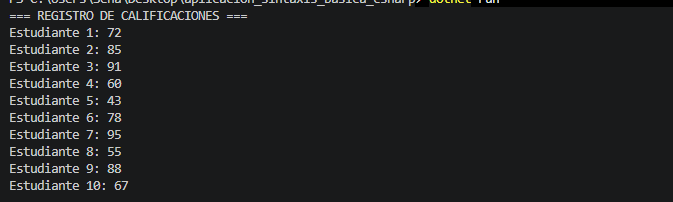
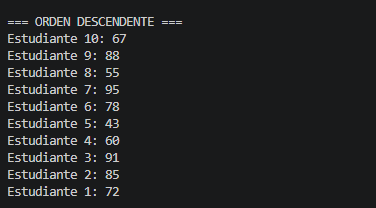
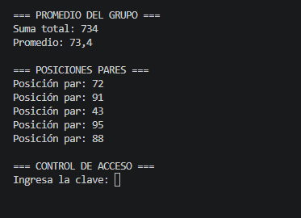
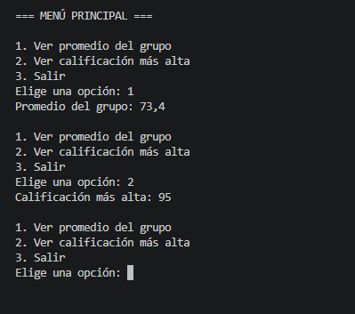

# Actividad SENA ADSO – Aplicación de la sintaxis básica de C#

## Descripción

Esta actividad tiene como objetivo aplicar los fundamentos del lenguaje de programación C# mediante ejercicios prácticos y un proyecto de consola, utilizando .NET para crear, ejecutar y organizar las soluciones.

Se trabajan conceptos fundamentales de programación y se aplican en situaciones prácticas para fortalecer la lógica y la resolución de problemas.

## Objetivos

- Comprender los tipos de datos, las variables y las constantes en C#.
- Utilizar operadores aritméticos y de asignación.
- Aplicar la interpolación de cadenas de texto.
- Implementar estructuras condicionales.
- Utilizar estructuras iterativas para recorrer datos y controlar la ejecución.
- Aplicar los fundamentos de la programación orientada a objetos.
- Desarrollar un programa interactivo mediante un menú de consola.
- Organizar el código fuente y utilizar Git para el control de versiones.

## Actividades desarrolladas

### 1. Tipos de datos, variables y constantes

Se utilizan diferentes tipos de datos de C#, como:

- `int`: números enteros.
- `double`: números decimales.
- `bool`: valores lógicos (`true` o `false`).
- `string`: cadenas de texto.
- `char`: caracteres individuales.

Se declaran variables, se asignan valores y se muestran los resultados mediante `Console.WriteLine()`.

### 2. Operadores

Se aplican operadores aritméticos y de asignación para realizar cálculos.

El ejercicio consiste en calcular el área y el perímetro de un rectángulo a partir de su ancho y alto. Posteriormente, se modifican los valores y se realizan nuevamente los cálculos.

### 3. Interpolación de cadenas

Se utiliza la interpolación de cadenas con `$"..."` para mostrar mensajes que incorporan los valores de las variables de forma clara y legible.

### 4. Estructuras condicionales

Se desarrolla la función `CheckNumber(int number)`, que recibe un número entero y devuelve un mensaje indicando si el número es positivo, negativo o cero.

Se utiliza la estructura `if-else` para evaluar las condiciones y se permite recibir el número mediante la entrada de datos por consola.

### 5. Estructuras iterativas

Se trabaja con un arreglo de calificaciones para practicar diferentes estructuras de repetición:

- `for`
- `foreach`
- `while`
- `do-while`

También se estudia el uso de `break` y `continue` para controlar la ejecución de los ciclos.

### 6. Proyecto de gestión de biblioteca

Se desarrolla un sistema de gestión de biblioteca mediante una aplicación de consola.

El menú contempla las siguientes opciones:

- Gestión de libros.
- Gestión de usuarios.
- Gestión de préstamos.
- Búsquedas y reportes.
- Guardar y cargar datos.
- Salir del programa.

El proyecto está orientado a la aplicación de la programación orientada a objetos, las operaciones CRUD (crear, consultar, actualizar y eliminar), el manejo de excepciones y la persistencia de datos, de acuerdo con los requisitos de la actividad.

## Tecnologías y herramientas

- **Lenguaje:** C#.
- **Plataforma:** .NET.
- **Editor de código:** Visual Studio Code.
- **Terminal:** PowerShell.
- **Control de versiones:** Git.
- **Repositorio remoto:** GitHub.

## Ejecución de los ejercicios

Para crear y ejecutar un proyecto de consola de C# desde PowerShell, se pueden utilizar los siguientes comandos:

```powershell
dotnet new console -n NombreProyecto
cd NombreProyecto
dotnet run
```

Para compilar el proyecto sin ejecutarlo:

```powershell
dotnet build
```

## Evidencias de ejecucion







Estos comandos deben ejecutarse desde la ubicación correspondiente y utilizando los nombres reales de las carpetas y proyectos.

## Organización del código

Los ejercicios se organizan en carpetas y archivos de código fuente con extensión `.cs`, según la estructura del proyecto. Se utiliza un archivo `.gitignore` para excluir archivos generados automáticamente y otros elementos que no necesitan incluirse en el repositorio.

## Conclusión

El desarrollo de esta actividad permite reforzar los fundamentos de C#, comprender las estructuras básicas de programación y avanzar hacia la construcción de aplicaciones de consola. Además, facilita la práctica de la lógica de programación, la organización del código y el uso de herramientas de desarrollo y control de versiones.

---

**Programa:** Análisis y Desarrollo de Software (ADSO)  
**Institución:** SENA  
**Actividad:** Aplicación de la sintaxis básica de C#  
**Aprendiz:** [Escribe tu nombre]
